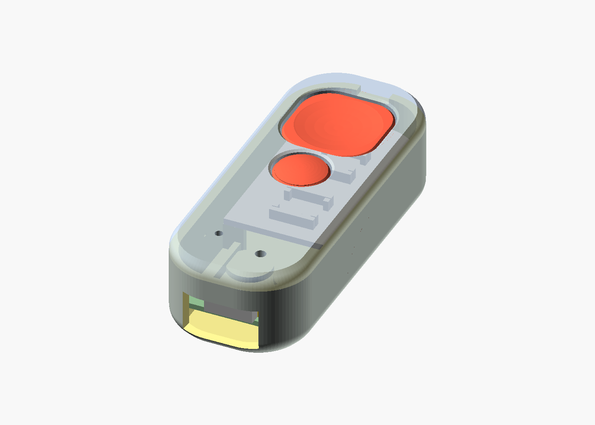

# read-remote

A silent two-button Bluetooth page turner for e-readers (KOReader on Android), built around a Seeed XIAO nRF52840 running ZMK.

- [`case/`](case/) — 3D-printable pebble case (OpenSCAD, STLs, renders, assembly guide).
- [`firmware/`](firmware/) — ZMK config; GitHub Actions builds the `.uf2`.

