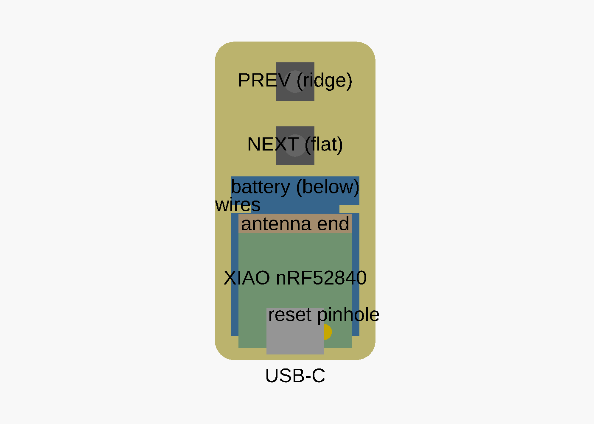
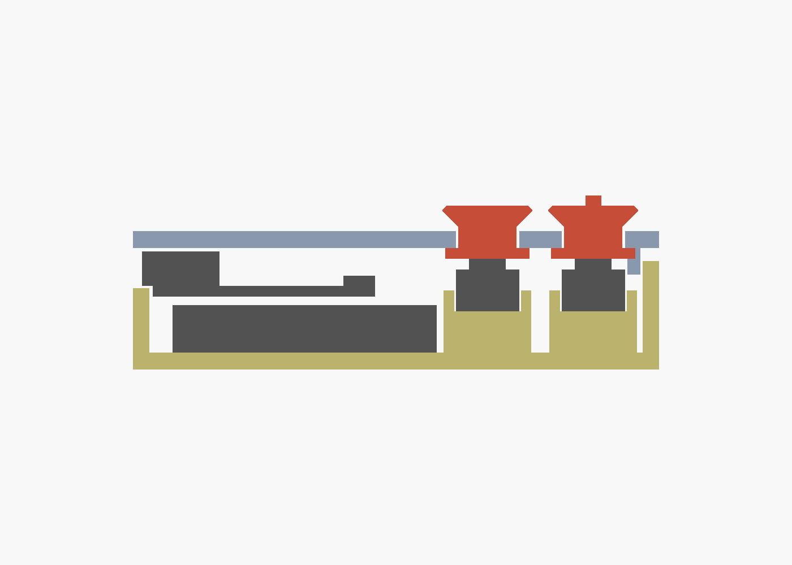

# page-turner-case

3D-printable case for a two-button ZMK page-turner remote: Seeed XIAO nRF52840 + 402025 LiPo + two 6×6×5 silent tactile switches. Hand-wired, no PCB.

Outer size with nominal parts: **25 × 64 × 14.5 mm**, pebble-shaped: both ends near-semicircular (r10), 2.5 mm rounded top edge, 3 mm rounded bottom edge. The PCB sits 3.3 mm back from the USB end wall so its corners clear the rounded cavity, so the USB opening is sized for the cable's overmold (12.5 × 7 mm, 45° lead-in) and spans the lid seam like a phone case; the plug body enters ~3.5 mm before the shell seats. The default layout is `kobo` (big dished NEXT at the rounded end, small domed PREV below it). Six other layouts are built in (`variant` in `page_turner.scad`); see [DESIGNS.md](DESIGNS.md). Four printed parts: `base`, `lid`, `plunger_next`, `plunger_prev`.

 

## Files
- `params.scad` — every dimension and clearance. Edit this, not the model.
- `page_turner.scad` — the model. `part=` selects what to render.
- `DESIGNS.md` — market research and the seven button-layout options.
- `render.sh <variant>` — exports `stl/<variant>/*.stl` and `renders/<variant>/*.png` (needs `openscad` on PATH; `brew install --cask openscad@snapshot`).

## Before printing: measure the real parts
Nominal values in `params.scad` are from datasheets. Caliper these and update:

| param | what to measure | nominal |
|---|---|---|
| `xiao` | PCB width × length × thickness | 17.8 × 21.0 × 1.0 |
| `xiao_comp_h` | PCB top to top of USB-C shell | 3.3 |
| `usb_overhang` | how far the USB-C shell nose sticks past the PCB edge | 1.0 |
| `reset_pos` | reset button centre: X from PCB centreline, Y from the USB edge | 4.5, 2.5 |
| `batt` | battery width × length × thickness, **including the PCM hump and tape** | 20 × 25 × 4.5 |

The PCB and battery corners sit just inside the rounded USB-end cavity; the model asserts this. If your XIAO or battery measures wider, raise `pcb_setback` / `lead_gap` or lower `r_plan_usb`.
| `sw_h` | switch: floor to top of silicone dome, unpressed | 5.0 |
| `sw_body` | switch body square | 6.0 |

`reset_pos` is the one most likely to be wrong; the pinhole is 1.6 mm so there is ±0.5 mm of slack.

## Printing (Bambu P1S)
- PLA (or PETG), 0.4 nozzle, 0.16 mm layers, 3 walls, no supports. The rounded bottom (base) and top (lid) edges start with a 45° blend at the bed so neither needs support; expect a faint facet line ~1 mm up from the bed edge.
- `base.stl`: open side up, as exported.
- `lid.stl`: exported **top-face down** (lip and snap bumps point up). Smooth or textured plate, your call; the textured plate gives the lid a matte top.
- `plunger_*.stl`: exported **cap up**, flange on the bed. Enable **ironing** on top surfaces so the caps are glossy-smooth. Print 2–3 of each; they are tiny.
- Keep all four parts on one plate.

## Fit tuning
| symptom | change |
|---|---|
| plunger binds in lid hole | `fit` 0.25 → 0.35 |
| plunger rattles / cap sits low | `preload` 0 → 0.1 (raises the switch shelf) |
| caps feel too flush / want deeper recess | `cap_recess` 0.5 → 1.0 |
| dish too shallow / dome too subtle | `dish_depth`, `dome_h` |
| different layout | `variant` in `page_turner.scad`, or edit the `caps` table |
| wider / rounder / flatter shell | `side_gap` (width), `r_plan_far`, `r_top`, `r_bot` |
| lid won't snap / too tight | `snap_bump` 0.4 → 0.3, or `lid_fit` 0.2 → 0.3 |
| lid loose | `snap_bump` 0.4 → 0.5 |
| switch loose in pocket | `pocket_fit` 0.15 → 0.1 |
| USB plug body doesn't fit | `usb_plug` [12.5, 7.0] → measure your cable's overmold and add 1 mm; `usb_flare` for the lead-in |

## Assembly
1. Solder battery leads to the BAT+/BAT− pads on the XIAO's underside. Keep the joints low. Cover the pads with Kapton tape.
2. Solder one 28 AWG wire to each leg of both switches (2 wires per switch, ~35 mm). Bend the leads so they exit sideways through the pocket slots.
3. Drop the switches into the two pockets, dome up, legs through the side slots. Add a dab of hot glue or CA on the pocket wall if they rattle.
4. Lay the battery in the base, PCM/lead end toward the USB wall, in the 2 mm lead gap.
5. Set the XIAO on the side rails, component side up, USB-C facing the end opening. It is captured between the rounded cavity corners (front) and the chamfered end stops (back).
6. Route switch wires along the side gaps beside the PCB and solder to the edge pads: NEXT switch → D0 and GND, PREV switch → D1 and GND (change in your ZMK keymap). Keep wires away from the antenna end (the tan strip in the layout render).
7. Drop the caps into the lid windows from underneath (flange inside, cap out). NEXT is the far cap, PREV the one nearer the USB end (variant 6: PREV is the end button; drop its flange in before the switch).
8. Press the lid on until the four side bumps snap in. To open, lift the lid edge at the USB opening with a fingernail. Thread a lanyard through the hole in the far end wall and knot it inside.

Reset: poke a paperclip into the pinhole above the USB end. Double-press for the UF2 bootloader.

## Design notes
- Each cap rests on its switch dome and is retained by a 1 mm flange under the lid. Travel (~0.25 mm) stops on the switch; the cap sits 0.5 mm below the lid surface in a window with 0.25 mm clearance, so plastic never meets plastic. On release the flange returns against the lid underside; the silicone dome makes that inaudible.
- No metal or thick plastic above the antenna end: the lid is a plain 1.6 mm plate there and the 3 mm `antenna_keepout` zone past the PCB is empty.
- The battery sits under the PCB; the stack is what sets the 13 mm height. The switch zone sits past the battery so the switch shelf can be solid.
