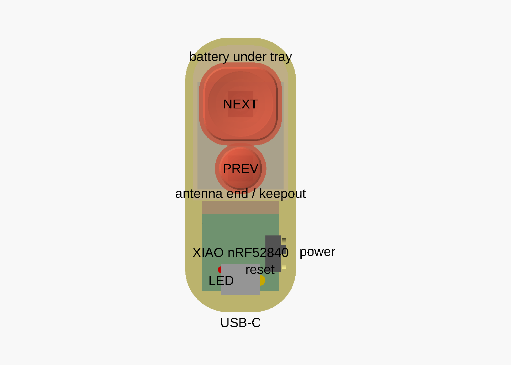
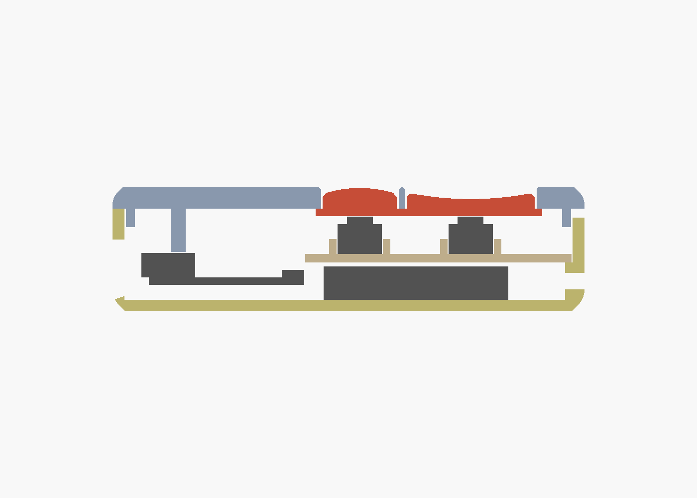
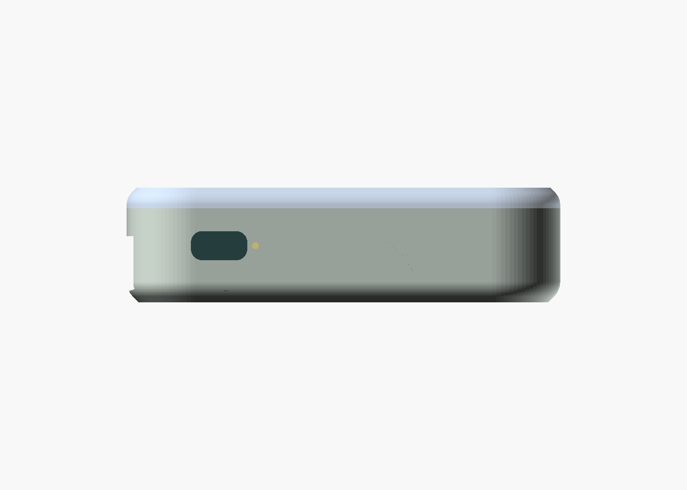
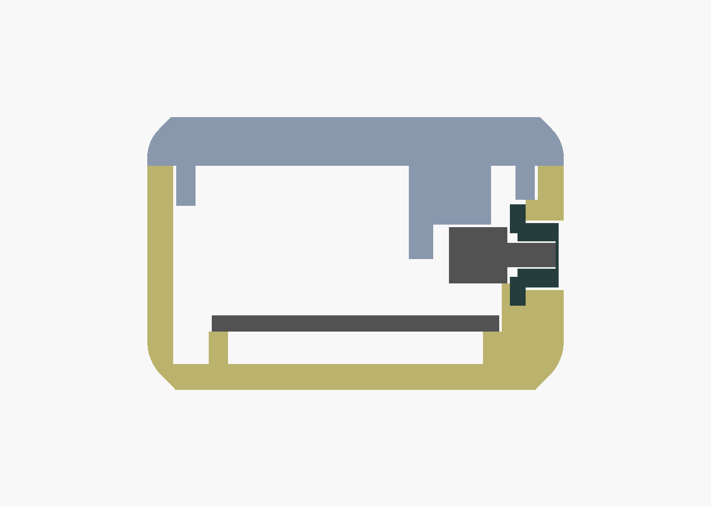

# page-turner-case

3D-printable case for a two-button ZMK page-turner remote: Seeed XIAO nRF52840 + 402025 LiPo + two 6×6×5 silent tactile switches + an SS12D00G3 slide switch as a hard power cutoff for travel. Hand-wired, no PCB. Everything drops in from the top; no glue.

Outer size with nominal parts: **26 × 64 × 17 mm**, pebble-shaped (r10 ends, rounded edges). The power slider is a flush 6 × 4 mm tile in the right side wall near the USB end. The default layout is `kobo` (big dished NEXT at the far end, small domed PREV below it). Five other layouts are built in (`variant` in `page_turner.scad`); see [DESIGNS.md](DESIGNS.md).

 

## Printed parts (6, plus a 3-piece fit coupon)
| part | what | print orientation |
|---|---|---|
| `base` | shell with PCB rails, battery bay, tray ledge, power-switch pocket and window | as exported, open side up |
| `lid` | cap windows, reset/LED pinholes, PCB and switch hold-downs, 4 snap fingers | exported **top-face down** |
| `tray` | drop-in plate carrying both tact switches | as exported, pockets up |
| `knob` | power-slider tile with inner flange; press-fits on the slide switch handle | as exported, flange on the bed (print 3, they are tiny) |
| `plunger_next` | big dished cap | as exported, cap up |
| `plunger_prev` | small domed cap | as exported, cap up |
| `coupon_base/lid/tray` | the button end only, for fit testing | same as the full parts |

**Print the coupon first** with both caps and real switches. It tests `fit`, `snap_bump`, `pocket_fit`, `tray_fit` and the cap stack height in a fraction of the time of the full set.

## Files
- `params.scad` — every dimension and clearance. Edit this, not the model.
- `page_turner.scad` — the model. `part=` selects what to render, `variant=` the button layout.
- `DESIGNS.md` — market research and the button-layout options.
- `render.sh <variant>` — exports `stl/<variant>/*.stl` and `renders/<variant>/*.png` (needs `openscad` on PATH; `brew install --cask openscad@snapshot`).

## Before printing: measure the real parts
Nominal values in `params.scad` are from datasheets. Caliper these and update:

| param | what to measure | nominal |
|---|---|---|
| `xiao` | PCB width × length × thickness | 17.8 × 21.0 × 1.0 |
| `xiao_comp_h` | PCB top to top of USB-C shell | 3.3 |
| `usb_overhang` | how far the USB-C shell nose sticks past the PCB edge | 1.0 |
| `reset_pos` | reset button centre: X from PCB centreline, Y from the USB edge | 4.5, 2.5 |
| `led_pos` | charge/status LED centre, same frame (1.5 mm light-pipe hole in the lid) | -4.5, 5.0 |
| `usb_plug` | your chunkiest cable's plug body W × H, plus 1 mm | 12.5 × 7.0 |
| `batt` | battery width × length × thickness, **including PCM hump and tape** | 20 × 25 × 4.5 |
| `sw_h` | switch: base to top of silicone dome, unpressed, **to 0.05 mm** | 5.0 |
| `sw_body` | switch body square | 6.0 |
| `psw` | slide switch body: length along the slide × depth along the handle × height | 8.6 × 3.6 × 3.5 |
| `psw_handle` | handle: along the slide × across × length past the body | 2.0 × 1.5 × 3.0 |
| `psw_travel` | slide throw | 2.0 |

`sw_h` matters most: the switch has 0.25 mm of travel, so the cap stack is built to ±0.1 mm. `preload` defaults to -0.1 (caps float 0.1 mm at rest, a faint tick if shaken, never pre-actuated). Only go positive if the caps rattle, and never above +0.1.

The model asserts that the PCB corners clear the rounded USB-end cavity and that the battery fits in its bay; if an assert fires it names the parameter to change.

## Power cutoff
An SS12D00G3 slide switch sits in the battery + lead, so OFF is a true disconnect: no wake on an accidental press in a bag, no BLE reconnects, zero drain. The switch body sits in a pocket on the right wall above the PCB edge, 2 mm above the board. Its handle pokes through a window in the wall into a printed knob: a 6 × 4 mm tile flush with the outside and a 1 mm flange inside, trapped between the wall and the switch body, so the knob can never fall out and nothing of the switch is visible. The wall is locally thickened to 2.35 mm so the G3 handle is used in full. A 1 mm dot next to the window marks ON (toward the buttons). **The switch must be ON to charge**: USB charges through the XIAO.

 

Tuning: `knob_fit` (tile in window), `knob_pocket_fit` (handle press fit; add a drop of CA if loose), `psw_fit` (body in pocket), `psw_y` (position), `psw_side` (-1 for the left wall).

## Printing (Bambu P1S)
- PLA, 0.4 nozzle, **0.10 mm layers** (so the switch shelf and lid heights land on layer boundaries), 3 walls, no supports.
- Lid on the **smooth or cool plate**: it prints top-face down, and a textured plate would texture the top. Caps print top-up with **ironing** on for glossy tops.
- Rounded bottom (base) and top (lid) edges start with a 45° blend at the bed; expect a faint facet line ~1 mm up.
- All parts fit one plate.

## Fit tuning
| symptom | change |
|---|---|
| cap binds in lid window | `fit` 0.25 → 0.35 |
| cap rattles / sits low | `preload` -0.1 → 0 (max +0.1) |
| cap pre-pressed, button always on | `preload` → -0.2, re-measure `sw_h` |
| lid won't snap / too tight | `snap_bump` 0.3 → 0.2, or `finger_h` 5.5 → 7 (softer) |
| lid loose | `snap_bump` 0.3 → 0.4 |
| switch loose in tray pocket | `pocket_fit` 0.15 → 0.1 |
| tray rocks | `tray_fit` 0.15 → 0.1 |
| knob binds in its window | `knob_fit` 0.15 → 0.25 |
| knob loose on the handle | `knob_pocket_fit` 0.1 → 0.05, or a drop of CA |
| USB plug body doesn't fit | `usb_plug`, `usb_flare` |
| want deeper button recess | `cap_recess` 0.5 → 1.0 |
| dish too shallow / dome too subtle | `dish_depth`, `dome_h` |
| buttons too far from the palm / too close | `cap_shift` (default 2.5 toward the USB end; 0 puts them at the far end) |
| different layout | `variant`, or edit the `caps0` table |
| wider / rounder shell | `side_gap`, `r_plan_far`, `r_top`, `r_bot` |

## Assembly
Wire: NEXT switch → **D0** and **GND**, PREV switch → **D1** and **GND**. Use the pads at the USB end of the XIAO (D0, D1 left; GND right); the lid pillars land on the bare antenna-end corners, so leave those pads empty. Battery: **−** straight to BAT−; **+** to the slide switch's middle pin, and the pin nearer the button end to BAT+ (that way the dot marks ON).

1. **Switches on the tray.** Drop each switch into its tray pocket (legs facing the open sides). Solder a ~40 mm 28 AWG wire to each leg right there; the tray is the fixture. Route the wires off the tray's front edge.
2. **Slide switch.** Clip its three pins to ~2 mm and bend them flat against the body (away from the handle). Solder ~40 mm wires to the middle pin and one end pin.
3. **Battery.** Solder BAT− to the XIAO's underside pad and the switch's end-pin wire to BAT+; the battery + lead goes to the switch's middle pin. Kapton over the joints. Lay the battery in the bay (the ring at the far end), lead end toward the PCB.
4. **PCB.** Set the XIAO on the two rails, component side up, USB-C toward the end opening. It is captured in Y between the rounded cavity corners and the end stops; nothing else to do.
5. **Knob and switch.** Push the knob through the wall window from inside, tile first, and slide it to the USB end of the window. Set the switch to the USB-end position, lower it into its pocket (handle toward the wall, pins toward the PCB) and push it outward until the handle seats in the knob. The lid's leg locks it there.
6. **Tray.** Lower the tray onto the ledge ring; its front edge rests on the PCB end stops. Solder the switch wires to D0 / D1 / GND. The gap above the PCB is 9 mm, so there is plenty of room.
7. **Caps and lid.** Put the lid face-down on the bench, drop the caps into their windows (flange up). Turn the loaded base over onto it (the tray and switches have only a few tenths of play) and press until the four fingers click.
8. **Open** with a fingernail in the notch at the far end. Thread a lanyard through the hole in the far wall and knot it inside.

Reset: paperclip into the pinhole above the USB end. Double-press for the UF2 bootloader. The second small hole next to it shows the charge/status LED.

## Design notes
- **Captured caps.** Each cap rests on its switch dome and is retained by a 1 mm flange under the lid. Travel stops on the switch; the cap sits 0.5 mm below the lid in a window with 0.25 mm clearance and a 0.4 mm chamfered edge, so plastic never meets plastic.
- **Battery away from the antenna.** The pouch (foil) sits under the switch tray, 3 mm past the board end and 2 mm below the antenna plane, instead of directly under the chip antenna.
- **PCB held three ways without glue.** Rails below; rounded cavity corners (front) and end stops (back) take plug insertion/removal loads; three lid pillars (two on bare PCB corners, one on the USB shell) stop it lifting.
- **Snap fingers.** Four 1 mm × 5.5 mm fingers on the lid lip with relief slots, 0.3 mm bumps into wall grooves: ~1.5–2 % strain, inside PLA's elastic range. The continuous lip only locates.
- **Power switch held four ways without glue.** Pocket end walls (Y), boss below and a lid block above (Z), the knob flange outside and a lid leg inside (X). The knob is trapped by its flange; the handle press fit only has to carry the slide.
- **USB opening** is sized for the cable's plug body (the receptacle sits 3.3 mm behind the wall) with a 45° lead-in; it sits entirely in the base, below the lid seam.
